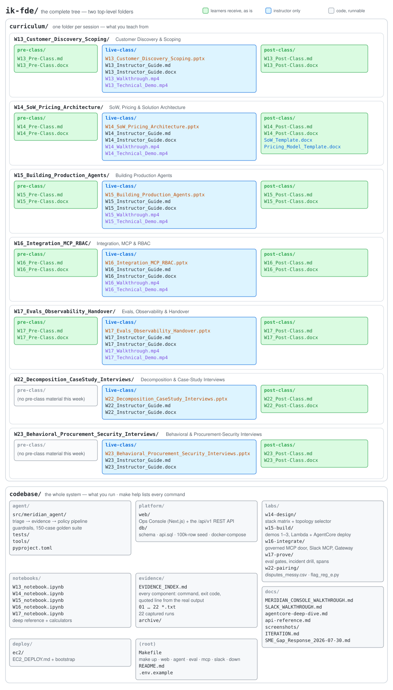

# IK FDE — The Meridian Engagement · instructor handover

Two folders. `curriculum/` is what you teach from; `codebase/` is what you run.

## Teaching a session

1. Open the week's `live-class/` folder: the deck and its Instructor Guide. The guide has everything that is not on the slides: the 24-hour prep and T-30 checks with the string each command must print, the minute-by-minute run of show with every poll worded verbatim, the persona scripts you read in character, the activity sheets with answer keys, the break/fix table, and teardown.
2. Before any session with a demo: `cd codebase && make doctor && make up && make web`. Every demo has a `--mock` path that needs no cloud account.
3. `pre-class/` and `post-class/` contain nothing for the instructor. Ops sends them to learners unchanged; the `.docx` is the same content as the `.md`.

| Week | Title | Pre-class | Post-class |
|---|---|---|---|
| W13 | Customer Discovery & Scoping | kickoff memo, case A with exhibits, pre-class assignment | M0 charter brief |
| W14 | SoW, Pricing & Solution Architecture | CIO memo, case B with exhibits, pre-class assignment, 15-item security questionnaire | M1 brief; `SoW_Template.docx` and `Pricing_Model_Template.docx` go with it |
| W15 | Building Production Agents | build-authorization memo | M2 brief, Deploy It Yourself, deploy checklist, leaderboard rules, further reading |
| W16 | Integration, MCP & RBAC | production-access memo | M3 brief |
| W17 | Evals, Observability & Handover | prove-and-hand-over memo | M4 brief |
| W22 | Decomposition & Case-Study Interviews | — | case prompts with the assignment, scoring rubrics |
| W23 | Behavioral & Procurement-Security Interviews | — | STAR+ story bank, first-90-days plan template |

## The codebase

`codebase/README.md` is the map. `make help` lists every command. `codebase/evidence/EVIDENCE_INDEX.md` lists every component with the command that proves it and a quoted line from the real output. The deep-reference notebooks are in `codebase/notebooks/`. Learners work in their own fork of this repo; the post-class documents point at it, and `AGENTS.md` is the context file their AI pair reads first.

## The portal

| Where | How | URL |
|---|---|---|
| Hosted class instance (always on) | nothing to do | <https://ik-fde-casestudy-bank.vercel.app> |
| Your laptop | `make up && make web` | `http://localhost:3100` |
| Your own EC2 box | `codebase/deploy/ec2/EC2_DEPLOY.md` | `http://<dns>:3100` |

Sign in with a seeded analyst: `jason.soto@meridianbank.com` (Type A) or `robert.joyce@meridianbank.com` (Type B). Email only; no password in this training build.

## Ground rules for delivery

- Every demo has a $0 offline path. If something dies mid-class, switch to `--mock` and say so.
- Never narrate a screenshot as if it were live. The captures are fallbacks.
- Tear down what you deploy: `./teardown.sh`, `agentcore destroy --force`, `make down`.
