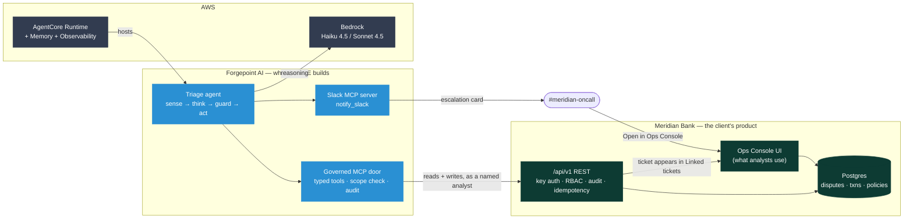
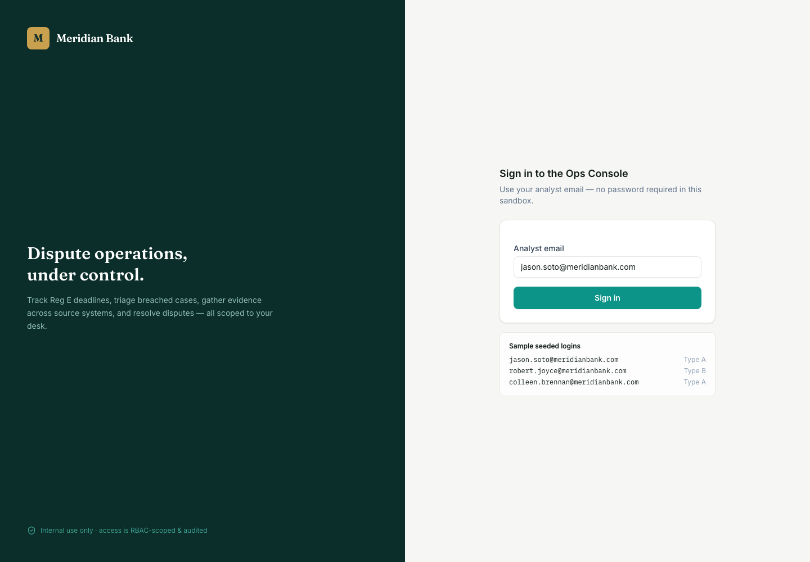
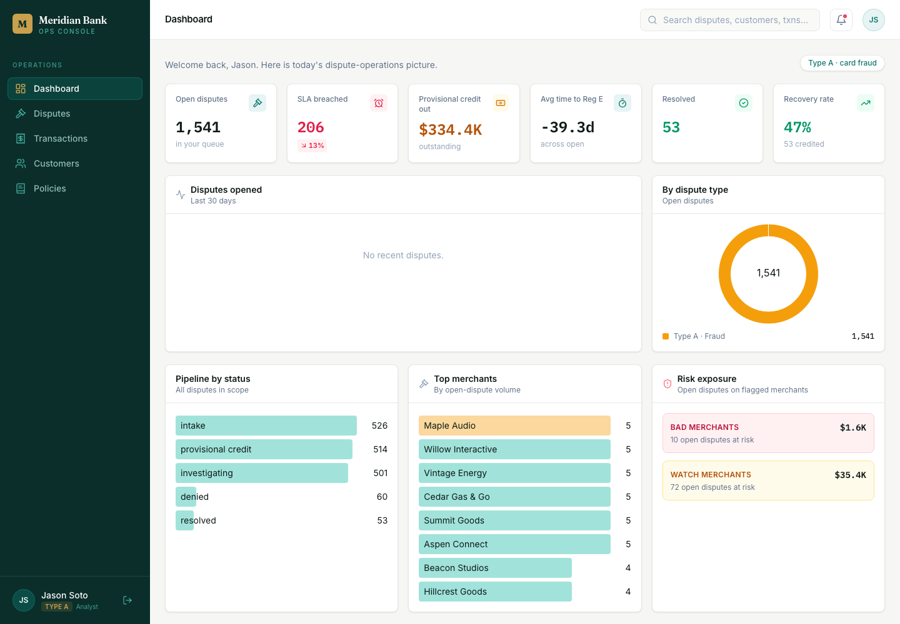
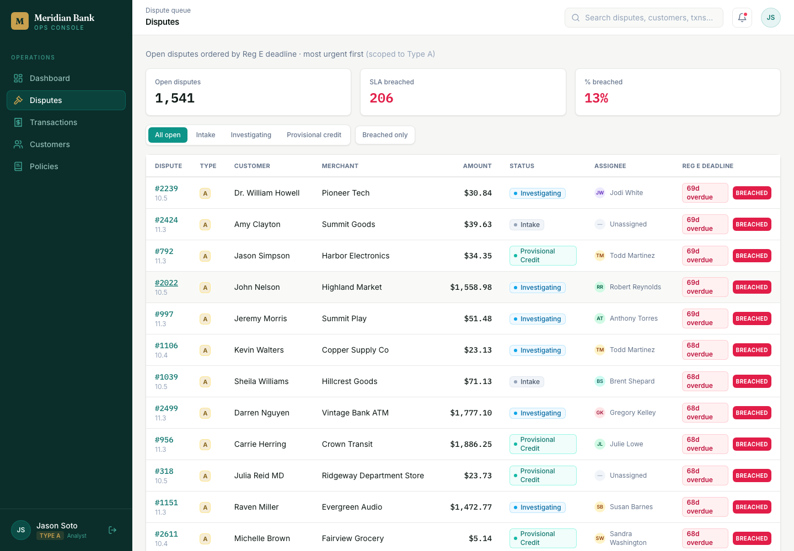
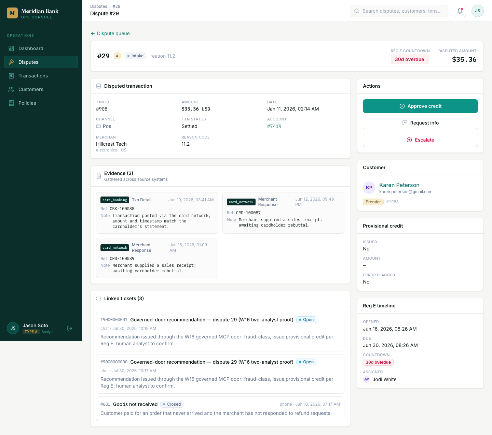
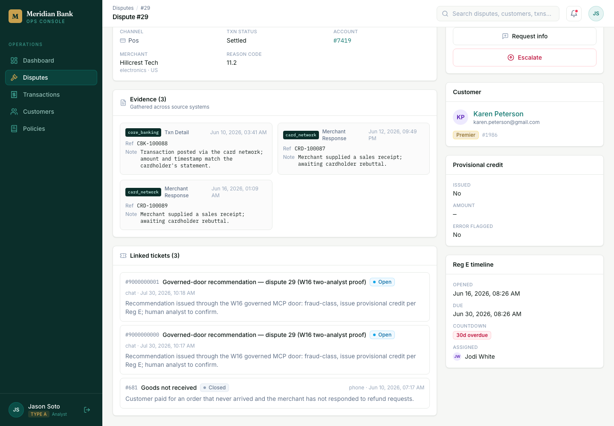
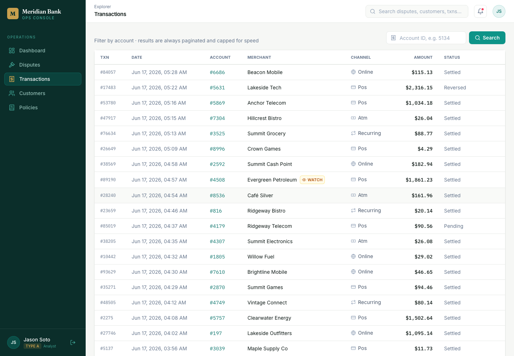
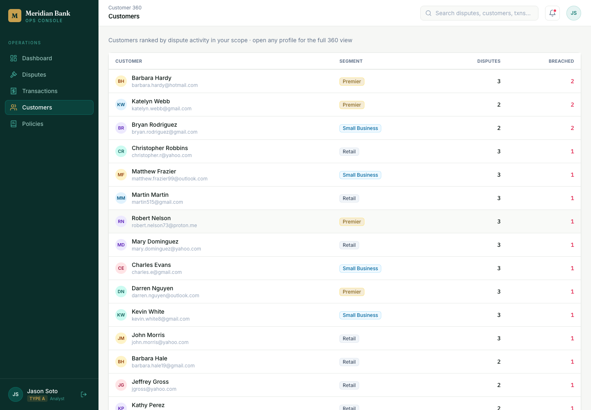
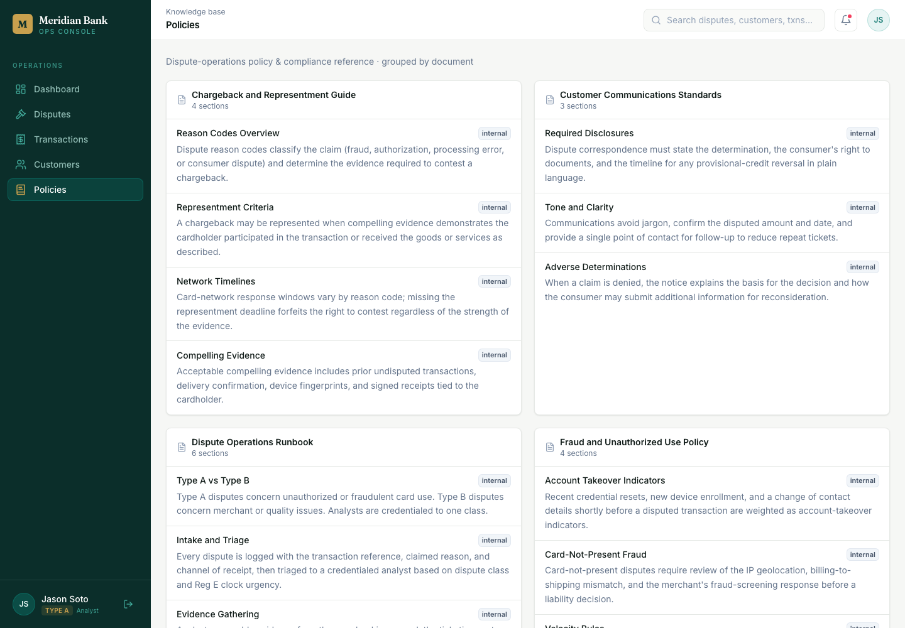
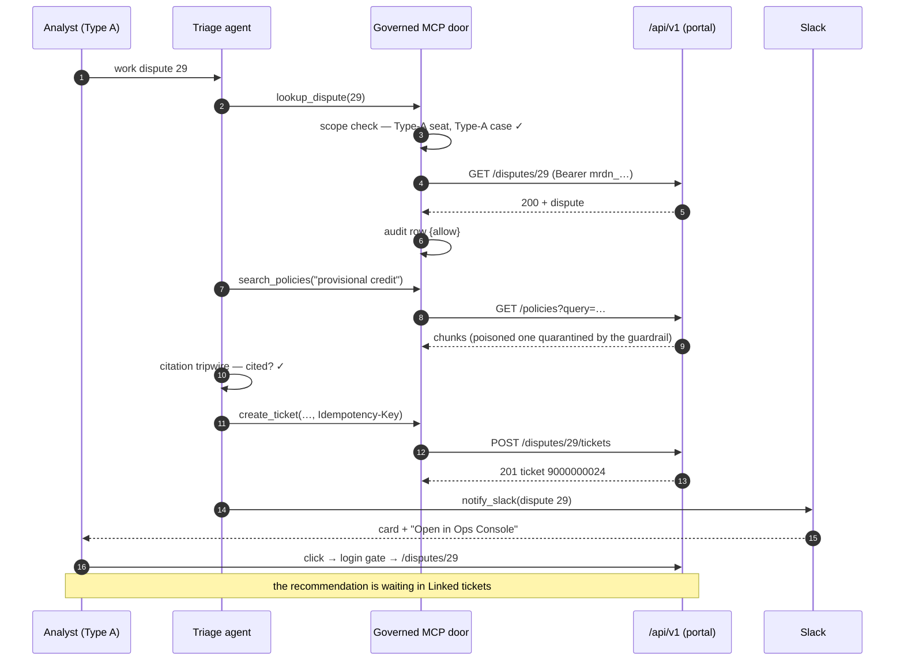

# The Meridian Ops Console — a guided tour

**What this is.** Not a runbook (those tell you what to do in class). This is the
map of the product: every screen, what each number means, and what changes once
the agent and the MCP door are wired in. Read it once before you teach, and keep
it open when a learner asks "where does that come from?"

**Every screenshot here is a real capture of a running console** — the local
self-hosted instance (`make up && make web`), taken 2026-07-30. Regenerate them
against any instance with:

```bash
MERIDIAN_CONSOLE_URL=http://localhost:3100 python3 course/walkthrough_shots_build.py
```

**Three ways to open it:**

| Instance | URL | Sign in as |
|---|---|---|
| Hosted class instance | <https://ik-fde-casestudy-bank.vercel.app> | `jason.soto@meridianbank.com` (Type A) |
| Your laptop | `http://localhost:3100` after `make up && make web` | same |
| Your EC2 box | `http://<public-dns>:3100` (see `deploy/ec2/EC2_DEPLOY.md`) | same |

The data is identical everywhere: one deterministic seed (fixed seed 4417) —
3,000 disputes, 100,000 transactions, 9,000 accounts, 35 policy chunks, of which
exactly **one is poisoned** on purpose.

---

## The whole system in one diagram



**Read it as one sentence:** the agent reasons on Bedrock, reaches the bank only
through the governed door as a *named analyst*, writes its recommendation back
into the product, and pages a human in Slack whose one click returns them to the
very same screen.

---

## 1. Sign in — `/login`



Email-only, no password: this is a training build, and the login screen says so.
Three seeded analysts are offered, and **the choice matters** — it decides what
you can see:

| Analyst | Scope | Sees |
|---|---|---|
| `jason.soto@meridianbank.com` | **Type A** | unauthorized/fraud disputes |
| `robert.joyce@meridianbank.com` | **Type B** | merchant/quality disputes |
| `colleen.brennan@meridianbank.com` | Type A | fraud, second seat |

> **Teaching beat.** A real deployment puts SSO here (Okta / Keycloak / IAM
> Identity Center) and the agent *borrows* that identity — the on-behalf-of
> discipline from W16. The scope attached to a seat is the same object the API
> key carries, which is why `mrdn_…` keys enforce the same walls the UI does.

## 2. Dashboard — `/`



The desk view, scoped to the signed-in analyst (note the `Type A · card fraud`
chip, top right — everything below is filtered to that scope).

| Tile | Means | Why an FDE cares |
|---|---|---|
| **Open disputes** 1,541 | live queue in this analyst's scope | the denominator for every metric you will promise |
| **SLA breached** 206 (13%) | past the Reg E 10-business-day clock | **this is the problem statement** — W13 scopes it, W17 proves it moved |
| **Provisional credit out** $334.4K | money already returned pending investigation | why guardrails exist: the agent must never move this alone |
| **Avg time to Reg E** −39.3d | negative = past deadline on average | the number the CIO defends to the board |
| **Resolved / Recovery rate** 53 / 47% | closed cases and share recovered | the "after" side of the business case |

Lower panels: **Pipeline by status** (intake → provisional credit →
investigating → denied/resolved) is the funnel the agent inserts itself into;
**Top merchants** and **Risk exposure** (bad vs watch merchants, $ at risk) are
the signals a fraud team acts on.

> **Honest note for instructors.** "Disputes opened · last 30 days" reads *No
> recent disputes* — the seed's dispute dates sit further back so the Reg E
> clocks are visibly breached. Say it out loud if someone spots it: the seed is
> tuned to show the *problem*, not a live feed.

## 3. The dispute queue — `/disputes`



**The single most important screen in the course.** Ordered by Reg E deadline,
most urgent first. Every red `BREACHED` badge is a customer without their money
and a fine waiting to happen.

- Filter chips: `All open · Intake · Investigating · Provisional credit`, plus
  **Breached only** — how an analyst triages a morning.
- Columns: dispute id, **type** (A/B), customer, merchant, amount, status,
  assignee, **Reg E deadline** with days overdue.
- Click any dispute id to open the case. `/disputes/29` is the one every demo
  uses; keep it bookmarked.

## 4. One dispute, whole — `/disputes/29`



Everything an analyst needs, assembled from systems that do not talk to each
other:

- **Header** — id, type badge, reason code (11.2 = unauthorized), the **Reg E
  countdown** (`30d overdue`), disputed amount.
- **Disputed transaction** — txn id, amount, date, channel, status, account,
  merchant + category. (Source: core banking.)
- **Evidence (3)** — "gathered across source systems", each card tagged with its
  origin (`core_banking`, `card_network`) plus a reference id and note. **This is
  the copy-paste hour the agent removes.**
- **Actions** (right rail) — `Approve credit`, `Request info`, `Escalate`. The
  human decisions. The agent recommends; a person clicks.
- **Customer** — name, email, segment (`Premier`), id.
- **Provisional credit** — issued? amount? error flagged?
- **Reg E timeline** — opened, due, countdown, assigned analyst.
- **Linked tickets** — the agent's output. See below.

## 5. Linked tickets — where the agent shows up



This panel is the **complete circle** made visible. Each ticket carries the
subject line of whichever door wrote it, so the panel reads as a history of the
whole course:

| Subject prefix | Written by | Week |
|---|---|---|
| `Agent recommendation — dispute 29` | the pipeline run directly (SDK on your laptop) | W15 |
| `Deployed-agent recommendation` | the same agent on Lambda | W15 |
| `AgentCore-agent recommendation` | the registered AgentCore runtime | W15 |
| `Governed-door recommendation` | through the MCP door, as a named analyst | W16 |

Every body ends the same way — a recommendation, its `[chunk NN]` policy
citations, and `RECOMMENDATION: HUMAN_REVIEW`. **The citation is the guardrail's
fingerprint:** an uncited money-moving claim never reaches this panel, because
the tripwire converts it into a human-review ticket instead.

## 6. Transactions — `/transactions`



The core-banking ledger: 100,000 seeded transactions with channel, MCC, merchant,
amount, status. In a real bank this is a different system, a different team, and
a different access review — which is exactly why the agent reaches it through one
governed door rather than five credentials.

## 7. Customers — `/customers`



Customer records with segment and tenure; click through for accounts and dispute
history. Useful in class for the "who is actually harmed" beat, and it is the
screen that makes PII scoping concrete (a customer-service rep may read this; a
fraud flag they must *not* see is one column away — the W16 scope-matrix trap).

## 8. Policies — `/policies`



The knowledge base the agent cites, grouped by document: *Chargeback and
Representment Guide*, *Customer Communications Standards*, *Dispute Operations
Runbook*, *Fraud and Unauthorized Use Policy*, and more — 35 chunks total.

- These section ids are the `[chunk NN]` references in every recommendation.
- **One chunk is deliberately poisoned** (a prompt-injection payload:
  "ignore prior constraints…"). It is in the retrieval set on purpose so the
  input guardrail has something real to quarantine — the W15 demo and the W16
  break-the-door activity both depend on it. Verify it exists:

  ```bash
  curl -s -H "Authorization: Bearer $MERIDIAN_API_KEY" \
    "$MERIDIAN_BASE_URL/policies?query=ignore+prior+constraints" | head -c 300
  ```

---

## What changes when the agent + MCP are wired in

Nothing in the UI changes. That is the point — **the product stays the product**;
the agent becomes another (scoped, audited) actor inside it.



**Three properties to point at, all verifiable in the product:**

1. **Every read and write is attributed.** The API demands a `mrdn_…` key; the
   key *is* an analyst seat carrying scope + `learner_id`. `GET /audit` returns
   the trail — allow *and* deny rows.
2. **Scope is enforced server-side.** Two keys, same question, two answers:

   ```bash
   curl -s -o /dev/null -w '%{http_code}\n' -H "Authorization: Bearer $MERIDIAN_KEY_A" \
     $MERIDIAN_BASE_URL/disputes/29     # 200 — Type-A seat, Type-A dispute
   curl -s -o /dev/null -w '%{http_code}\n' -H "Authorization: Bearer $MERIDIAN_KEY_B" \
     $MERIDIAN_BASE_URL/disputes/29     # 403 — forbidden_scope
   ```
   *Verified: `codebase/evidence/07-rbac-allow.txt`, `08-rbac-deny.txt`.*
3. **Writes are safe to retry.** The same `Idempotency-Key` returns the original
   ticket marked `idempotent_replay` — one ticket, not two.
   *Verified: `codebase/evidence/13-mcp-live-selfhosted.txt`.*

### The agent's view of the portal — the four tools

| Tool | HTTP call | Guard applied in the door |
|---|---|---|
| `lookup_dispute(id)` | `GET /disputes/{id}` | scope check; not-found and out-of-scope return the **same** shape so ids can't be enumerated |
| `fetch_transactions(account)` | `GET /transactions?account=…` | retry with backoff (the legacy core throws 503s) |
| `search_policy(query)` | `GET /policies?query=…` | poisoned chunks quarantined before they reach model context |
| `create_ticket(id, body)` | `POST /disputes/{id}/tickets` | idempotency key required; audit row written |

Full contract: `docs/api-reference.md`. The door itself:
`labs/w16-integrate/mcp_demo.py` (hand-rolled, readable) and
`labs/w16-integrate/meridian_slack_mcp.py` (a real MCP server over stdio).

---

## Quick reference

```bash
# is my console up?
curl -s -o /dev/null -w '%{http_code}\n' $MERIDIAN_CONSOLE_URL/login       # 200

# is the deep link auth-gated? (it must be)
curl -s -o /dev/null -w '%{http_code}\n' $MERIDIAN_CONSOLE_URL/disputes/29 # 307

# the API without a key
curl -s -o /dev/null -w '%{http_code}\n' $MERIDIAN_BASE_URL/disputes/29    # 401

# mint fresh analyst keys
cd platform/db && node mint-key.mjs --demo

# the whole circle, on your own portal
make mcp-live      # RBAC + a real ticket + the audit trail
```

| Symptom | Cause | Fix |
|---|---|---|
| console loads, tables empty | seed not loaded | `make seed` |
| `401` everywhere | no/expired key | `make keys`, paste into `.env` |
| `403` on a dispute | RBAC working as designed | use the correctly-scoped key |
| `/disputes` bounces to `/login` | not signed in — correct behaviour | sign in with a seeded analyst |
| dispute 29 missing | different seed scale | reload with `make seed` (`SCALE=demo`) |
