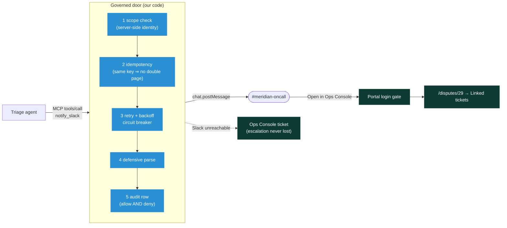
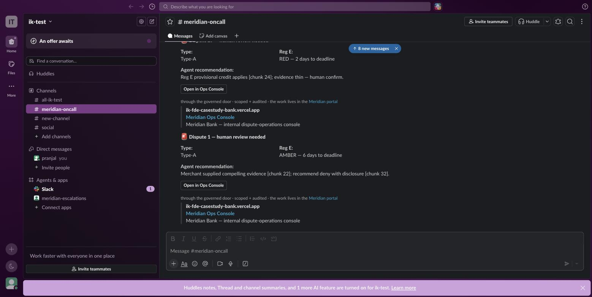
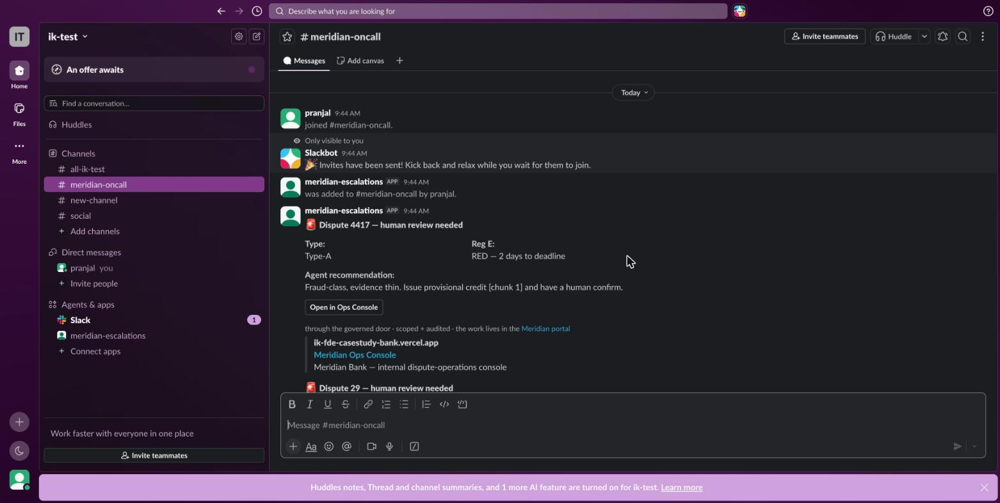
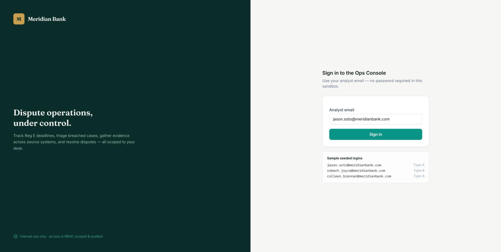
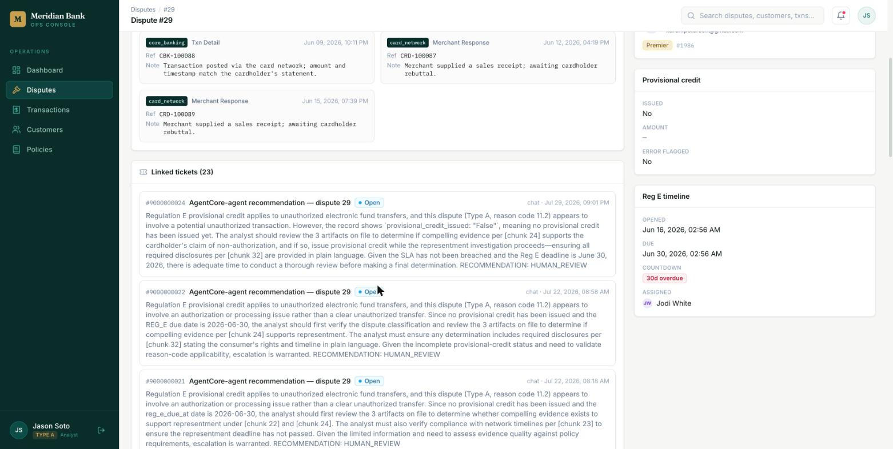

# The Slack escalation — a live-tested walkthrough

**What this is.** The escalation leg, end to end: how it's set up, how it's wired
through MCP, and every scenario run against a **real Slack workspace** with its
real output pasted in. Everything below was executed on **2026-07-30** in
workspace `ik-test`, channel `#meridian-oncall`, bot `meridian-escalations`
(`B0BLWT46U9J`). Transcripts: `evidence/14-slack-offline.txt`,
`15-slack-mcp-selftest.txt`, `16-slack-live-post.txt`, `17-slack-auth.txt`, and
the scenario sweep in `labs/w16-integrate/logs/slack_scenarios_2026-07-30.txt`.

**Why it exists.** The pilot user's W15 verdict was that the agent was
"articulate and useless." An agent that reasons well but cannot *reach a human*
has not shipped. The escalation closes that gap — and it must do so without
becoming a hole in the bank's access control.

---

## The path, in one diagram



**The rule the diagram encodes: the card carries a *link*, never the data.**
Slack says *what happened*; the portal decides *who may see it*.

---

## Part 1 — Setup (workspace owner, ~5 minutes)

### 1.1 Create the app from the manifest

1. Create a workspace at <https://slack.com> (free plan is fine).
2. <https://api.slack.com/apps> → **Create New App** → **From a manifest** →
   pick the workspace → paste `labs/w16-integrate/slack_app_manifest.yaml` →
   **Create**. This creates **Meridian Escalations** with exactly two scopes:
   `chat:write`, `chat:write.public`.
3. **Install App** → **Allow**.

### 1.2 Collect two values

| Value | Where | Looks like |
|---|---|---|
| **Bot token** | app page → *OAuth & Permissions* → *Bot User OAuth Token* | `xoxb-…` |
| **Channel ID** | create `#meridian-oncall` in Slack → click the channel name → *About* | `C…` |

Put them in `labs/w16-integrate/.env` (git-ignored — **never commit a token**):

```
SLACK_BOT_TOKEN=xoxb-…
SLACK_CHANNEL_ID=C…
```

### 1.3 Invite the bot to the channel

```
/invite @meridian-escalations
```

> **Least privilege, discovered live.** Our install came through with
> `chat:write` + `channels:history` — **not** `chat:write.public`. Two real
> consequences, both worth teaching: the bot can only post where it was
> *invited*, and `conversations.list` returns `missing_scope` (needs
> `channels:read`) so **the app cannot enumerate the workspace**. That is the
> correct posture for a bank. Verified output:
>
> ```json
> {"ok": false, "error": "missing_scope",
>  "needed": "channels:read,groups:read,mpim:read,im:read",
>  "provided": "channels:history,chat:write"}
> ```

### 1.4 Verify the token

```bash
curl -s -H "Authorization: Bearer $SLACK_BOT_TOKEN" https://slack.com/api/auth.test
```

Real output (`evidence/17-slack-auth.txt`):

```json
{"ok": true, "url": "https://ik-testworkspace.slack.com/", "team": "ik-test",
 "user": "meridianescalations", "team_id": "T0BLT66EPD0",
 "user_id": "U0BLLUZENGK", "bot_id": "B0BLWT46U9J"}
```

### 1.5 Optional: the Slack CLI

The Slack CLI is handy for inspecting apps and tailing activity. It is **not
required** for anything in this course — everything uses `curl` and the Web API.

```bash
curl -fsSL https://downloads.slack-edge.com/slack-cli/install.sh | bash
slack login                 # opens a browser, or prints a /slackauthticket slash command
slack auth list             # which workspaces am I authenticated to?
slack app list              # the apps in this workspace
slack activity --tail       # live event/log stream while you demo
```

If `slack login` prints a ticket command, paste it into any Slack message box in
the workspace and approve. Prefer the CLI for *inspection*; keep the escalation
path itself on the Web API so learners see the raw HTTP contract.

---

## Part 2 — Two rungs, and the MCP door

| Rung | Command | Posts as | Governance |
|---|---|---|---|
| 1 · Incoming webhook | `SLACK_WEBHOOK_URL=… make slack-live` | an anonymous hook | our door's checks still apply |
| 2 · **Bot token (production)** | `SLACK_BOT_TOKEN + SLACK_CHANNEL_ID`, `make slack-live` | the **app**, visible as `APP` in Slack | our door's checks + real Web API semantics (`ok:false`, `Retry-After`) |
| 3 · **Through MCP** | `make slack-mcp` / any MCP client | same as rung 2 | same, and now *any* agent can call it |

### Wiring it into an MCP client

```bash
# Claude Code
claude mcp add meridian-slack -- python3 $PWD/labs/w16-integrate/meridian_slack_mcp.py

# Claude Desktop — claude_desktop_config.json
{"mcpServers": {"meridian-slack": {
  "command": "python3",
  "args": ["/abs/path/labs/w16-integrate/meridian_slack_mcp.py"],
  "env": {"SLACK_BOT_TOKEN": "xoxb-…", "SLACK_CHANNEL_ID": "C…"}}}}
```

**Identity is server-side.** `MERIDIAN_ACTING_EMAIL` / `MERIDIAN_ACTING_SCOPE`
are read from the environment, never from tool arguments — so a model cannot pass
someone else's badge. That is the on-behalf-of discipline in one design decision.

### The off-the-shelf alternative (and why we don't ship it)

`npx -y @modelcontextprotocol/server-slack` wires Slack to any agent in five
minutes. It also hands the raw bot token to the model with **no** Meridian scope
check, **no** audit row, and **no** idempotency. Fine on a laptop; indefensible
in a bank's security review. Show it, then show ours — the contrast *is* the
lesson.

---

## Part 3 — Every scenario, with its real output

All seven run offline in one command (`make slack`), and each can be run alone
with `--simulate <name>`. Verbatim from
`labs/w16-integrate/logs/slack_scenarios_2026-07-30.txt`:

| # | Scenario | Real output | What it proves |
|---|---|---|---|
| 1 | `happy` | `posted to Slack, audit row written` | the normal path |
| 2 | `rbac` | `403 DENIED — analyst_b@meridian.test (scope=type_b) may not escalate Type-A to Slack` + `decision: deny` audited | **scope is enforced even for an outbound notification** — Slack is never called |
| 3 | `rate_limit` | `attempt 1: 429 rate-limited → backoff 1s, retrying` → `delivered_via=slack` | exponential backoff honours `Retry-After` |
| 4 | `expired_webhook` | `hard failure (slack 404: invalid_token) → not retryable` → `graceful fallback → ticket TCK-4417-fallback` | a rotated credential does **not** lose the escalation |
| 5 | `timeout` | `circuit-breaker TRIPPED after 2 consecutive failures` → 3rd call `reason=circuit_open` | the breaker stops hammering a dead dependency |
| 6 | `duplicate` | `idempotency: key 'dup-1' already sent → returning prior result` → `deduped=True` | the on-call human is paged **once** |
| 7 | `schema_drift` | `defensive-parse: unexpected Slack response body '{"status":"accepted"…}'; HTTP was 200 → treating as delivered, flagging for review` | a changed response shape does not crash the agent |

Plus a **real** Slack API error, provoked live against a bad channel id:

```json
{"ok": false, "error": "channel_not_found", "warning": "missing_charset"}
```

That is why `SlackBotTransport` maps `ok:false` onto the same `SlackError` the
backoff/breaker logic already understands — the hardening lives in the door, not
in the transport.

---

## Part 4 — Live: multiple inputs, distinct outputs

Four `tools/call` requests driven through the **real MCP stdio protocol** (the
full JSON-RPC exchange is in the scenario log):

| Input | Arguments | Live response |
|---|---|---|
| **A** | dispute 29, Type-A, `RED — 2 days`, cites `[chunk 24]`, idem `wt-29` | `isError=false`, `delivered_via: slack`, audit `decision: allow` |
| **B** | dispute 1, Type-A, `AMBER — 6 days`, cites `[chunk 22]`+`[chunk 32]`, idem `wt-1` | `isError=false`, `delivered_via: slack`, separate audit row |
| **C** | **replay of A** (same idem key) | `isError=false`, **`deduped: true`** — not re-posted |
| **D** | dispute 1502, **Type-B** (seat is Type-A) | `isError=true`, `error: access_denied`, audit **`decision: deny`** |

The two distinct cards in the channel — different clock colours, different
citations:



The card as the on-call analyst sees it, posted by `meridian-escalations APP`:



## Part 5 — The handoff back to the portal

The button is the whole point. Clicking **Open in Ops Console** lands on the
portal's **login gate** — the deep link is auth-gated, so a forwarded card leaks
nothing:



Sign in as the seeded analyst and you arrive on the dispute, with the agent's
recommendation already in **Linked tickets**:



**Self-hosting:** the card follows `MERIDIAN_CONSOLE_URL`. Point it at your own
portal and the button opens *your* box:

```bash
export MERIDIAN_CONSOLE_URL="http://localhost:3100"        # or your EC2 DNS
make slack-live
```
*Verified live: the same run against `http://localhost:3100` is in the scenario log.*

---

## Part 6 — Teach it in class (W16, ~7 minutes)

| Beat | Command | What the room sees |
|---|---|---|
| 1. the normal path | `make slack` | `PROBLEM → HANDLED` for all seven scenarios, scrolling |
| 2. the deny | `python3 slack_integration_demo.py --simulate rbac` | Slack never called; a `deny` row written |
| 3. **live** | `make slack-live` | a real card appears in `#meridian-oncall` on screen |
| 4. through MCP | `make slack-mcp` | `SELFTEST PASS (transport mode: bot)` — dedupe + deny included |
| 5. the circle | click **Open in Ops Console** | login gate → dispute → Linked tickets |

**Fallback if Slack is unavailable:** run steps 1–2 (offline, deterministic) and
show the screenshots in this doc for steps 3–5. Say plainly that they are
captures — never fake a live run.

## Troubleshooting

| Error | Meaning | Fix |
|---|---|---|
| `not_in_channel` | bot was never invited | `/invite @meridian-escalations` |
| `channel_not_found` | wrong `SLACK_CHANNEL_ID`, or a private channel | re-copy the ID from *About* |
| `invalid_auth` | token revoked/rotated | reinstall the app, re-copy the bot token |
| `missing_scope` | the call needs a scope you didn't grant | add it in *OAuth & Permissions*, **reinstall**, re-copy the token |
| `ratelimited` | you're posting too fast | the door already backs off; nothing to fix |
| card posts but the button 404s | `MERIDIAN_CONSOLE_URL` points at a portal that isn't running | `make web`, or use the hosted URL |
